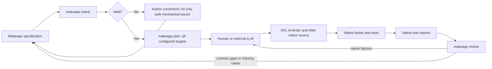

# RFC-0001: Makeapp declarative application specification language and CLI

## Context

Individual developers, small product teams, and coding agents need one checked contract for application behavior, UI, and acceptance cases across native platforms. Makeapp proposes a declarative application specification language and offline Rust verification CLI. Humans or external, provider-independent coding models use its contracts and implementation plans to author native applications; the CLI neither invokes models nor generates or modifies native source.

The initial proof is a local-only task manager on iOS, Android, and Web. Application data persists across restarts, storage failures remain explicit, and each target uses its native APIs without a shared application rendering runtime. These are proposal assumptions and scope choices, not implemented capabilities.

Backend services, deployment, cloud sync, authentication, collaboration, arbitrary embedded platform code, and desktop application implementations are outside v0.1. Editor extensions, language servers, MCP servers, plugin marketplaces, and general-purpose language features are deferred. CLI host support for macOS, Linux, and Windows is separate from application-target support.

The intended benefit is to propagate contract changes across targets without restating shared requirements and tests in separate prompts. Token savings, readability, native idiomaticity, and performance require the [measurement gates](#performance-and-risks); this proposal reports no measured gains.

This RFC remains proposed, not accepted or implemented. Makeapp is a working name whose public package and trademark availability must be checked before release. [ADR-0001](../decisions/0001-use-makespec-to-manage-decisions-and-specifications.md) governs this record's lifecycle.

## Requirements and constraints

### Requirements

| ID | Priority | Requirement |
| --- | --- | --- |
| FR-001 | MUST | The Makeapp language MUST express typed entities, values, enums, errors, invariants, ports, use cases, adapters, targets, and a single unnamed shared `host` entry point. |
| FR-002 | MUST | The checker MUST enforce clean-architecture references, type and name correctness, complete port contracts, target bindings, and inferred use-case dependencies and failures. |
| FR-003 | MUST | The language MUST express a typed shared UI tree with reusable components and slots, local state and forms, explicit query reloads, navigation, responsive layout, themes, design tokens, and accessibility metadata. |
| FR-004 | MUST | The CLI MUST provide `check`, `fix`, `test`, `plan`, and `review` commands with documented human and versioned JSON output. |
| FR-005 | MUST | `test` MUST execute bounded domain and UI-state scenarios using controlled fakes and report mismatched results, errors, calls, logs, or navigation without using real application storage or network services. |
| FR-006 | MUST | `plan` MUST produce a deterministic implementation guide from the checked specification and `makeapp.toml`, covering every configured target, requirements, dependencies, expected native artifacts, native implementation guidance, performance budgets, and relevant tests. It MUST NOT require target or task selectors, mutate Makeapp sources, invoke an LLM, or truncate output; an optional token budget MUST fail with the measured size when exceeded. |
| FR-007 | MUST | `review` MUST inspect every configured application target without requiring a target selector, compare native test reports against the complete expected case set derived from colocated Makeapp tests, report stale or missing artifact mappings, and distinguish automated conformance from source-boundary and manual UI evidence. |
| FR-008 | MUST | The reference product MUST be implemented as native iOS, Android, and Web applications from the same Makeapp contracts, with local persistence and no shared application rendering runtime. |
| FR-009 | MUST | The reference task manager MUST support creating, editing, completing, deleting, filtering, listing, and viewing tasks, and MUST preserve data across application restarts. |
| FR-010 | MUST | Presentation actions MUST support local structured logging with fixed fields and literal event names; logs MUST exclude dynamic task data, and domain, query, and rendering code MUST NOT log. |
| FR-011 | MUST | Before full parser implementation, the project MUST compare equivalent braced and indentation-based language samples, including the same module graph and representative project-local imports, record token counts and controlled editing/repair results, and select the initial syntax based on those results. |
| FR-012 | MUST | `plan` MUST instruct external LLMs to implement runtime-critical behavior with each target's native UI, lifecycle, navigation, persistence, and concurrency APIs, and MUST include the applicable performance budgets. `review` MUST report deviations from these native implementation constraints and distinguish source-boundary evidence from measured runtime performance. |
| FR-013 | MUST | Makeapp v0.1 MUST recursively load every `.mkap` file beneath each configured source root. Each file MUST define a module identified by its exact project-relative file path, with no module declaration or name conversion. Ambiguous source roots or paths MUST be rejected, and resolution MUST be independent of file order. |
| FR-014 | MUST | Cross-module references MUST use named imports of the form `import { Name } from "./file.mkap"`, resolved relative to the importing file with the exact extension specified. Import specifiers MUST include the `.mkap` extension in v0.1. Imported names MUST bind locally without module qualification. Duplicate bindings, inaccessible names, self-imports, and import cycles MUST be errors. Aliases, default imports, namespace or wildcard imports, and re-exports MUST NOT be supported in v0.1. |
| FR-015 | MUST | Makeapp v0.1 imports MUST resolve only to project modules discovered under configured source roots. Standard-library, package, remote, and network imports MUST be unsupported; built-ins MUST be available without imports. |
| FR-016 | MUST | Named top-level declarations MUST be private to their file unless prefixed with `export`. Imports MUST access only exported declarations. Exported contracts MUST expose only built-in or exported types and errors, including inferred failures. Separate export lists, default exports, and exporting an imported binding MUST be unsupported. The checker MUST discover the unique `host`, configured targets, and tests without exports. |
| NFR-001 | MUST | `fix` and machine-readable command output MUST be deterministic; `fix` MUST apply the canonical spacing rules in Design, preserve comments, string literals, templates, fixture contents, and semantics, and be idempotent. `check` MUST report spacing deviations without writing. |
| NFR-002 | MUST | Static CLI commands and scenario evaluation MUST work offline and MUST send no telemetry. |
| NFR-003 | MUST | Parsing, evaluation, input sizes, collections, child processes, output, and execution time MUST have documented bounds; limit failures MUST be explicit and MUST NOT appear as successful results. |
| NFR-004 | MUST | Token, CLI, and application performance claims MUST be backed by reproducible measurements with tokenizer, toolchain, device, OS, and fixture details where applicable. Device-specific performance gates MUST be agreed before declaring a target complete. |
| NFR-005 | MUST | Diagnostics MUST have stable codes, severity, project-relative source locations, explanatory messages, and remediation guidance; JSON output MUST follow a versioned schema. |
| NFR-006 | MUST | Each target MUST meet numeric cold-start and critical-interaction latency budgets on a named low-power reference device or browser client using release builds. Budgets MUST cover cold start to usable UI and P95 input-to-visible-response for representative local interactions, and MUST be agreed before full application implementation expands. |
| NFR-007 | MUST | Before claiming token-efficiency gains, the project MUST compare aggregate LLM input and output tokens for a conforming three-target implementation against equivalent independent prose-based per-platform prompts, using the same model, tokenizer, acceptance cases, and repair policy, including all repair rounds. The initial proposed target is at least 20% fewer input tokens. Report input and output tokens separately; do not claim output-token or total-cost savings before measurement. |

### Constraints

| ID | Constraint |
| --- | --- |
| C-001 | The CLI MUST be implemented in Rust and released as native host binaries for macOS, Linux, and Windows. |
| C-002 | Humans or external coding models own native application source and native test harnesses; Makeapp and its CLI MUST NOT generate native source code or execute model inference. |
| C-003 | The initial application proof MUST target iOS, Android, and Web. Windows, Linux, and macOS application profiles are planned or unsupported, never reported as verified targets. |
| C-004 | The reference application MUST be local-only. Cloud sync, authentication, collaboration, and remote application services are out of scope. |
| C-005 | Makeapp source MUST remain platform-neutral: no native platform API snippets, arbitrary embedded platform code, network imports, or shell directives. |

## Options

Assessments below are design-time judgments based on this proposal and inspected project records. They are not measurements, completed implementation work, or evidence that the combined options have been validated in practice.

### Language surface and syntax selection

| Criterion ID | Evidence-gated selection between braced and indentation syntax | Adopt braced syntax without measurement | Adopt indentation syntax without measurement | Schema-first declarations with embedded expressions |
| --- | --- | --- | --- | --- |
| FR-001 | Fully meets - either candidate must express the same typed declaration and behavior contract before selection. | Fully meets - explicit blocks can express the required declarations. | Fully meets - indentation can express the required declarations. | Partially meets - data is representable, but executable contracts need custom embedded conventions. |
| FR-002 | Fully meets - both candidates are evaluated for type checking, architecture rules, full-port contracts, and inferred dependencies/failures. | Fully meets - block notation can express the declarations and checker rules. | Fully meets - indentation can express the declarations and checker rules. | Partially meets - the data model needs custom mechanisms for resolved behavior and architectural checks. |
| FR-011 | Fully meets - the project measures equivalent samples and records results before selection. | Does not meet - no comparison or evidence informs the syntax choice. | Does not meet - no comparison or evidence informs the syntax choice. | Does not meet - it does not compare the two requested language candidates. |
| NFR-001 | Fully meets - the selected grammar receives a canonical, deterministic formatter. | Fully meets - a canonical formatter can normalize braces. | Fully meets - a canonical formatter can normalize indentation. | Fully meets - canonical serialization is possible. |
| C-005 | PASS - the grammar comparison does not permit platform-specific source escapes. | PASS - the grammar can forbid platform-specific source escapes. | PASS - the grammar can forbid platform-specific source escapes. | PASS - the schema can forbid platform-specific source escapes. |

**Chosen option:** Evidence-gated selection between braced and indentation syntax

FR-011 gates full parser work on the [syntax comparison](#syntax-and-validation-reference). The examples illustrate candidates; they do not establish a syntax or token-efficiency winner.

### Module identity and local visibility

| Criterion ID | Relative named imports and explicit exports | Derived dotted modules with qualified imports | Declared modules with named imports | Project-wide namespace without imports |
| --- | --- | --- | --- | --- |
| FR-013 | Fully meets - exact project-relative file paths identify modules without declarations or name conversion. | Does not meet - paths need conversion into dotted identifiers. | Does not meet - authors must maintain a separate module name. | Does not meet - declarations have no file-scoped module identities. |
| FR-014 | Fully meets - named imports specify an exact `.mkap` file, bind exported names locally, and reject conflicts and cycles. | Does not meet - cross-module references require module qualification. | Does not meet - imports resolve declared names rather than relative file paths. | Does not meet - every declaration is visible without an import boundary. |
| FR-016 | Fully meets - an export prefix defines the public boundary; other declarations remain private. | Fully meets - qualified module imports can also enforce export prefixes and private defaults. | Fully meets - declared modules can enforce export prefixes and private defaults. | Does not meet - a shared namespace lacks a private file scope. |

**Chosen option:** Relative named imports and explicit exports

FR-013, FR-014, and FR-016 remove manually maintained module names while preserving a private file scope. [File modules, imports, and exports](#source-syntax-and-modules) defines resolution, visibility, and move handling; those rules do not override architecture boundaries.

### External import sources

| Criterion ID | Project modules only | Vendored, locked packages | Network-fetched packages |
| --- | --- | --- | --- |
| FR-015 | Fully meets - imports resolve only to modules discovered under configured source roots. | Does not meet - independently resolved vendored packages are outside the configured project source set. | Does not meet - registry packages are outside the configured project source set. |
| NFR-002 | Fully meets - source loading and checks require no network access or telemetry. | Fully meets - vendored sources and lock data are available offline. | Does not meet - fetching or resolving packages requires network access. |
| C-005 | PASS - project module imports remain platform-neutral. | PASS - this option assumes vendored packages contain only platform-neutral Makeapp source. | FAIL - network package imports violate the no-network-import constraint. |

**Chosen option:** Project modules only

FR-015 bounds loading to the complete project source set. Copied local source is project source, not a separately resolved dependency. Package manifests, registries, and external resolution are deferred.

### Shared interface model

| Criterion ID | One typed, shared UI and state model | Duplicated platform-specific Makeapp UI trees | Prose-only screen descriptions |
| --- | --- | --- | --- |
| FR-003 | Fully meets - one checked tree declares reusable elements, state, routes, themes, layout, and accessible semantics. | Partially meets - each target can specify its interface, but structure and behavior can drift. | Does not meet - prose does not provide typed bindings or checkable UI states. |
| FR-010 | Fully meets - action-scoped logs and their observable records can be specified and tested alongside UI behavior. | Partially meets - logging rules must be repeated and checked separately on each target. | Does not meet - log placement, fields, and payload restrictions are not machine-checkable. |
| C-005 | PASS - platform differences are in target profiles and bindings, not shared screen declarations. | FAIL - platform-specific UI declarations violate the platform-neutral Makeapp source constraint. | PASS - prose can omit platform APIs, but does not meet the functional UI requirement. |

**Chosen option:** One typed, shared UI and state model

The shared tree gives the checker and UI-state tests one platform-neutral contract. The initial primitive catalog stays bounded and expands only when the reference app or a focused fixture requires it. Each target profile maps supported properties and capabilities to native implementations; the tree does not promise pixel-identical rendering.

### Native implementation ownership

| Criterion ID | Human or external-model native implementation with Makeapp verification | Generate native source from Makeapp | Generate shared core and UI, with native integration supplied externally |
| --- | --- | --- | --- |
| FR-006 | Fully meets - implementation plans give agents the contracts, dependencies, and target context they need. | Partially meets - generated code can be included, but the chosen ownership boundary is lost. | Partially meets - plans can cover the remaining integration, but much native code is still generated. |
| FR-007 | Fully meets - native harnesses report conformance against test cases derived from Makeapp. | Partially meets - generated tests can run, but native source ownership and independent test sensitivity are weakened. | Partially meets - verification is possible, but generated source adds another artifact contract. |
| FR-012 | Fully meets - plans direct external models to target-native APIs and review reports deviations. | Partially meets - generated source could use native APIs, but bypasses the external-LLM implementation workflow. | Does not meet - the shared UI runtime conflicts with the required native implementation direction. |
| NFR-006 | Fully meets - separate native implementations can be measured and tuned against each target's low-power budgets. | Partially meets - native output is possible, but each target still needs measured latency evidence. | Does not meet - a shared runtime adds an abstraction layer to latency-critical UI paths. |
| NFR-007 | Fully meets - shared contracts and target-aware plans are measured for input and output tokens against repeated prose prompts. | Does not meet - it does not define the comparable external-LLM implementation and token-measurement workflow. | Partially meets - shared code may reduce some generated output, but target-specific integration context and token use remain. |
| C-002 | PASS - humans and external models own native source; the CLI checks and exports data only. | FAIL - native source generation violates the constraint. | FAIL - generating core or UI produces native application source. |
| C-005 | PASS - target APIs stay in native projects and target bindings. | PASS - platform-specific APIs can remain outside Makeapp source. | PASS - platform-specific APIs can remain outside Makeapp source. |

**Chosen option:** Human or external-model native implementation with Makeapp verification

C-002 keeps source generation and model-provider selection outside the CLI. Makeapp exports checked-model data, plans, and test fixtures; the [verification workflow](#cli-and-native-verification) distinguishes these contracts from native implementation evidence.

### CLI implementation stack

| Criterion ID | Rust workspace and native CLI | Go module and native CLI | TypeScript CLI with bundled runtime |
| --- | --- | --- | --- |
| C-001 | PASS - Rust is the required implementation and supports native host binaries. | FAIL - Go violates the specified implementation constraint. | FAIL - TypeScript with a bundled runtime is not the required Rust native CLI. |
| NFR-002 | Fully meets - commands can run locally without network services or telemetry. | Fully meets - commands can run locally without network services or telemetry. | Fully meets - commands can be implemented locally, subject to packaging. |
| NFR-003 | Fully meets - the CLI can enforce explicit input, evaluator, and process bounds. | Fully meets - the CLI can enforce explicit bounds. | Fully meets - the CLI can enforce explicit bounds. |
| NFR-005 | Fully meets - the CLI can publish one stable diagnostic contract across commands. | Fully meets - the CLI can publish one stable diagnostic contract. | Fully meets - the CLI can publish one stable diagnostic contract. |

**Chosen option:** Rust workspace and native CLI

The Rust stack is a scope constraint, not a benchmark result. Keep compiler logic in a core crate and filesystem, process, and terminal I/O in a CLI crate. Dependencies and parser strategy remain implementation choices subject to the language evaluation and reproducible builds.

### Verification and application proof

| Criterion ID | Layered checks, bounded evaluator, implementation plans, and native conformance | Static checks and fixes only | Run scenarios only in the Makeapp reference evaluator |
| --- | --- | --- | --- |
| FR-004 | Fully meets - the command set includes checking/fixing, scenario evaluation, implementation planning, and native verification. | Partially meets - static commands work, but scenario evaluation and native verification are absent. | Partially meets - behavior runs, but static checks, fixes, implementation planning, and native verification are absent. |
| FR-005 | Fully meets - evaluator scenarios control ports and observe outcomes without real services. | Does not meet - static checks do not execute scenarios. | Fully meets - scenarios can be evaluated against controlled fakes. |
| FR-006 | Fully meets - deterministic whole-project context and optional budget enforcement are part of the pipeline. | Does not meet - static checks alone do not produce an implementation plan. | Does not meet - an evaluator alone does not produce implementation plans. |
| FR-007 | Fully meets - target verification compares native reports with complete derived case sets and reports evidence boundaries. | Does not meet - no native conformance or traceability check exists. | Does not meet - reference evaluation is not native implementation evidence. |
| FR-008 | Fully meets - the shared contract is checked against all three target implementations. | Partially meets - static support does not demonstrate that each native implementation conforms. | Partially meets - evaluator scenarios do not establish native UI or persistence behavior. |
| FR-009 | Fully meets - application-level tests cover operations and restart persistence on each target. | Partially meets - the product can be built, but this approach does not verify its full behavior. | Partially meets - the evaluator can cover domain rules but not real native storage or UI. |
| NFR-001 | Fully meets - deterministic formatting and exports are checked across the pipeline. | Fully meets - static formatting and exports can be deterministic. | Partially meets - scenario output may be deterministic, but canonical formatting is not included. |
| NFR-003 | Fully meets - evaluator and process bounds produce explicit failures. | Partially meets - parser inputs can be bounded, but evaluator/process behavior is outside the approach. | Fully meets - evaluator bounds can be tested explicitly. |
| C-002 | PASS - CLI exports contracts and derived fixtures but no native source. | PASS - static tools do not generate native source. | PASS - the evaluator does not generate native source. |
| C-003 | PASS - the reference proof covers iOS, Android, and Web and marks desktop unsupported. | PASS - application scope can target the three platforms. | PASS - application scope can target the three platforms. |
| C-004 | PASS - application adapters use local persistence only. | PASS - application scope can remain local-only. | PASS - evaluator fakes avoid remote services. |

**Chosen option:** Layered checks, bounded evaluator, implementation plans, and native conformance

Static validation, reference scenarios, native tests, source-boundary review, and manual UI review establish different kinds of evidence. A passing scenario suite does not prove all-input equivalence, an implementation plan does not prove correct model behavior, and a native SDK choice does not prove performance. The verifier MUST report missing test cases and unsupported targets rather than filling gaps with defaults.

### Initial application target scope

| Criterion ID | Three native targets: iOS, Android, and Web | iOS and Web only | Six targets: iOS, Android, Web, Windows, Linux, and macOS |
| --- | --- | --- | --- |
| FR-008 | Fully meets - it implements each target required for the initial proof. | Partially meets - Android proof is absent. | Fully meets - it includes the required targets plus desktop. |
| FR-009 | Fully meets - the same task-manager behavior and local persistence are required on all three. | Partially meets - the product proof omits Android. | Fully meets - it can implement the task manager on all required targets. |
| NFR-004 | Fully meets - named-device gates can be established per target before completion claims. | Partially meets - measurement omits one required mobile platform. | Partially meets - six platform gates expand scope before the three-target proof is validated. |
| C-003 | PASS - matches the required initial target set and keeps desktop status explicit. | FAIL - omits Android from the initial proof. | FAIL - treats desktop application targets as initial deliverables. |
| C-004 | PASS - local storage adapters can serve the task manager on each target. | PASS - the targets can use local storage. | PASS - target choice does not require cloud services. |

**Chosen option:** Three native targets: iOS, Android, and Web

The selected scope is the smallest candidate that includes every required initial target while keeping native desktop work out of the proof. CLI host binaries remain a separate concern and support macOS, Linux, and Windows. Native application completion requires the corresponding toolchain or device evidence; an emulator result cannot substitute for an unavailable physical-device performance measurement.

The selected options are compatible at the proposal level: the typed UI model remains platform-neutral, native source stays human- or model-owned, Rust tooling produces checked plans and test data rather than source, and the layered verifier checks the same scenarios across all three targets. These judgments do not establish that the syntax, CLI, or performance targets are feasible; adoption gates below require that evidence before target completion.

## Design

The requirements define acceptance obligations; the following sections own their detailed contracts. Options explain tradeoffs, examples illustrate syntax, and Adoption defines implementation gates. Do not infer missing grammar, schema, or catalog definitions from a snippet: resolve the [open choices](#adoption) at their stated gates.

| Implementation concern | Contract owner |
| --- | --- |
| Layers, types, inference, and effects | [Language contracts](#language-contracts) |
| Source identities, imports/exports, arguments, callbacks, naming, and formatting | [Source syntax and modules](#source-syntax-and-modules) |
| UI state, slots, navigation, capabilities, logs, and scenarios | [UI and scenario contracts](#ui-and-scenario-contracts) |
| CLI/workspace boundaries, plans, artifact mappings, and native evidence | [CLI and native verification](#cli-and-native-verification) |
| Product behavior, target delivery, and file examples | [Reference application and examples](#reference-application-and-examples) |
| Syntax lookup, comparison, and rejected forms | [Syntax and validation reference](#syntax-and-validation-reference) |
| Performance, risks, release gates, and unresolved choices | [Performance and risks](#performance-and-risks), [Adoption](#adoption) |

### Language contracts

#### Architecture and execution

Makeapp uses `.mkap` source files and `makeapp.toml` to select an edition, source roots, targets, and native implementation roots. A project declares exactly one unnamed `host`; configured targets provide native startup and composition.

The model has four checked layers: entities and values; use cases and inner-owned ports; adapters; and framework-level host, screens, components, navigation, and target composition. The checker resolves declaration kinds and references rather than trusting directory names. Entities cannot depend on ports or presentation. Use cases cannot name concrete adapters. Screens cannot bypass use cases to reach repositories. Target bindings must supply compatible adapters and required capabilities. Adapter contracts cover every operation of the referenced port.

| Layer | Owned declarations | Allowed source references |
| --- | --- | --- |
| Entities | Entities, values, enums, invariants, domain errors | Domain types and pure built-ins |
| Use cases | Use cases, application errors, inner-owned ports | Entities and port contracts |
| Adapters | Adapter declarations and native implementation mappings | Inner contracts, entities, and declared adapter configuration |
| Frameworks | Shared host, screens, components, navigation, and target composition | Inward contracts and adapters through explicit target wiring |

The checker rejects outward source dependencies even when runtime calls use injected ports. Declaration initialization, component expansion, and composition dependency graphs are acyclic; navigation may cycle. Colocated test stubs and assertions are test-driver roots and do not create production dependencies or target binding requirements.

The first type set includes booleans, portable exact integers, text, typed identifiers, records, enums, lists, and optional values. UI lengths, colors, typography, radius, and motion use separate validated catalog types. Floating-point domain arithmetic, dates, time zones, recursion, unbounded loops, dynamic evaluation, arbitrary native snippets, shell directives, and user-defined higher-order functions are deferred or excluded.

Entities and values are immutable; entities carry identity, and constructors check their declared invariants. `let` creates an immutable local; `set` updates existing presentation state without mutating domain values.

`Void` is the successful return type for an operation with no result. A `Void` use case completes by reaching the end of its body or executing a bare `return`. A value-returning use case must return a value or fail on every reachable path. `Void` calls execute as statements and cannot supply a data value. The evaluator represents completion internally; there is no authored completion literal. Successful completion remains distinct from optional `none` and typed failure.

Optional widening is allowed, but implicit narrowing is not. `if let` narrows the present value within its branch. Safe access `?.` and fallback `??` handle absence, not failures.

The portable integer proposal is the exact JSON/JavaScript integer range, from -9007199254740991 through 9007199254740991, with checked overflow. Candidate text semantics for the syntax study use `trim` over ASCII space, tab, carriage return, and newline; `length` counts Unicode scalar values; and text ordering compares Unicode scalar sequences. These are provisional semantics from the worked example and must be retained or revised with explicit fixtures before edition 0.1 is frozen. Numeric wire encodings, equality, nullability, and line-ending behavior must also be specified before native conformance work.

Use cases contain bindings, constructors, conditionals, bounded collection operations, port calls, `return`, and typed `fail`. Dependencies are inferred from resolved calls; failures are inferred from fallible constructors, `try`, and declared port failures. Port signatures declare their external failures; use cases do not duplicate inferred failure lists. Optional absence is distinct from failure.

`try` propagates a typed failure through a use case to exactly one matching presentation action handler. A failed action skips remaining success statements, runs its matching handler once, and does not resume the success path. Handlers cover every inferred action failure and cannot themselves perform fallible calls in edition 0.1. Cancellation and evaluator resource limits are not domain errors.

Effectful port calls execute serially in source order, without implicit parallelism, retry, or compensating transactions. Combine failures across typed branches conservatively, including branches that appear unreachable from current prose or examples. Native storage atomicity remains an adapter contract tested against the real implementation.

#### Source syntax and modules

The loader recursively discovers and checks every `.mkap` file beneath the manifest's `sources` directories, including files with no importers. Each file sees its own declarations, built-ins, and explicitly imported names. The checker discovers `host`, configured targets, and tests without exports; these roots cannot be imported or exported. FR-015 excludes standard-library, package, remote, and network imports.

Each configured source root is an existing project-relative directory within the project. Reject duplicate or overlapping roots, roots outside the project, and symbolic links in source-root path components or anywhere beneath a source root; this keeps each source file associated with exactly one root and prevents traversal outside it. Reject invalid or unreadable roots and source files rather than silently omitting them.

The exact project-relative file path, including `.mkap` and using `/` separators, identifies a module. For example, `src/tasks/create-task.mkap` remains that path; the checker does not convert it to a dotted identifier. Reject case-insensitive source-path collisions for portability. Files in different source roots can share a root-relative path because their project-relative identities differ. Resolution is case-sensitive and does not depend on root or file enumeration order.

Use `import { Task, TaskTitle } from "./task.mkap"` to bind exported declarations to local names. Import paths are literal strings beginning with `./` or `../`, use `/` separators, and include the exact `.mkap` extension. Resolve the specifier relative to the importing file and normalize `.` and `..` segments without adding or replacing an extension. The resolved file must remain inside the project and belong to a configured source root; crossing between configured roots is allowed. Reject extensionless specifiers with guidance to include `.mkap`, and reject unsupported file types. Also reject trailing slashes or terminal `.`/`..` segments, missing files, case mismatches, absolute paths, backslashes, URLs, bare package names, and paths outside the source set. Do not search other extensions or try directory/index lookup. Two specifiers resolving to the same file refer to one module. Import cycles, including self-imports, are errors even when the imported declarations are types.

Explicit extensions leave room for future resource imports without extension-search rules. Resource imports remain outside v0.1 and require a separate design for binding syntax, typing, validation, and target packaging; retaining extensions does not authorize loading non-Makeapp files.

Named imports bind only the listed declarations, without qualification. Reject missing or private exports, duplicate imported bindings, and conflicts with a local top-level declaration or built-in name. Local top-level declaration names must also be unique. Two distinct files may export the same name, but a consumer cannot import both into the same scope in v0.1. Importing a declaration does not make its dependencies or its source file's imports visible. An inferred type or failure retains its defining identity, but spelling its name in the consumer requires a direct import from its defining file.

Prefix a named declaration with `export` to expose it to other files. Everything else is private by default. For declarations with dot-separated authored names, such as `color.background`, the import lists that exact name; the dots remain part of the declaration name rather than a module qualifier. Exported contracts must expose only built-in or exported types and errors, including types nested in fields and operation signatures and failures inferred from exported use cases. This rule does not require exporting private implementation helpers or dependencies used only inside a body. Imported bindings cannot be exported again. Separate export lists, default exports, aliases, namespace/wildcard imports, and re-exports are outside v0.1. Import and export spellings apply to both syntax candidates; FR-011 still selects the surrounding block syntax.

For versioned model data, native mappings, and reports, qualify declarations and tests with their project-relative file path and owning name; these identities are metadata, not source-level module qualifiers. Moving or renaming a source file changes its module identity when its project-relative path changes. Authors must update affected import paths and retained implementation-manifest and test identities; reports or mappings with old identities are stale or missing until updated. `fix` does not perform renames or migrate these references.

Use the following naming conventions in both syntax candidates:

| Scope | Convention | Examples |
| --- | --- | --- |
| Makeapp source filenames and feature directories | kebab-case, with the extension separate | `create-task.mkap`, `task-editor/` |
| Import paths | Literal relative file paths, preserving filename spelling and extension | `"./task.mkap"`, `"../shared/task-id.mkap"` |
| Type-like declarations and enum variants | PascalCase | `TaskTitle`, `CreateTask`, `TaskFilter.Active` |
| Fields, parameters, locals, members, actions, state, resources, forms, slots, styles, and target names | camelCase | `errorMessage`, `getAll`, `openTask`, `draft`, `ios` |
| Token names and literal log-event names | Dot-separated camelCase segments | `color.background`, `space.extraSmall`, `task.saveFailed` |
| Catalog properties, built-ins, test selectors, and assertions | Exact camelCase spelling | `onChange`, `fieldError` |
| Test descriptions and user-facing text | Natural language | `test "invalid input keeps the editor open"` |

Names are case-sensitive. Treat acronyms as words (`TaskId`, `uiState`). Hyphens separate filename words, not identifier words; expression parsing must not depend on spaces around subtraction. Keywords and catalog constants retain their documented spellings, including `host`, `none`, and `alert`; the unnamed `host` has no identifier.

Apply these rules to Makeapp source paths and authored names. Preserve tool-mandated filenames such as `Cargo.toml` and native SDK naming conventions. TOML keys, routes, and external profile, capability, and implementation keys follow their own contracts and are not rewritten by the checker. `makeapp check` reports naming violations with the expected spelling; valid but noncanonical names remain warnings, not type errors. Invalid import paths, unresolved names, and binding conflicts are errors under the resolution rules above. Warnings are the default; `--strict` treats them as errors for CI. `makeapp fix` preserves names and never renames symbols, files, test descriptions, or log events. Explicit renames must update references and implementation-manifest identities together.

Retain import braces to group named bindings, parentheses to delimit calls and nested expressions, square brackets for lists and list types, and `Id<Task>` for typed identities. Block braces remain provisional until the FR-011 comparison selects braces or indentation; punctuation count alone is not evidence of lower token use or fewer repair rounds.

Application-defined calls, including constructors, ports, use cases, components, screens, and actions, accept positional and named arguments. Positional arguments bind in declaration order and must precede named arguments. A named argument binds an unbound parameter by its exact name; reject unknown labels, duplicate bindings, missing required arguments, excess arguments, and type mismatches. Built-ins and catalog widgets retain their documented positional inputs and named options.

Prefer positional arguments for simple forwarding, such as `TaskRepository.setCompleted(id, completed)`, and labels where they clarify values, such as `TaskRepository.rename(id, title: name)` or `CreateTask(title: "Read")`. Both styles follow the same binding rules; labels are not a type-safety requirement. `fix` preserves the author's choice rather than adding or removing labels. Public fields, parameters, and return types remain explicit; local bindings and use-case failures remain inferred. Keep `return` explicit when returning a value, and keep `try` and `fail` explicit. Use `->` for successful return types and callback bodies; declaration and expression context determine its role.

For canonical formatting, apply these rules to both syntax candidates; blank lines improve readability and never alter block structure. `makeapp check` MUST report noncanonical spacing without changing source. `makeapp fix` MUST apply the following spacing rules deterministically and idempotently:

- At module scope, keep related single-line declarations of the same kind together. Separate adjacent declarations with one blank line when either is multiline, and always separate use cases, entities, enums, values, ports, adapters, screens, components, and tests.
- Place named imports at the beginning of the file, sorted by literal source path, with one blank line before declarations. Within a single-line import, use `import { Name, OtherName } from "./file.mkap"`, with one space inside each brace and after commas. Preserve authored name order within braces. Keep `export` on the same line as the declaration keyword, separated by one space.
- Do not add blank lines between entity fields, value fields, enum variants, port operation signatures, or other members that form one declaration. Do not add blank lines immediately inside braces.
- Within use cases, actions, and tests, use one blank line to distinguish setup, validation, processing, side effects, and final results. Keep closely related local declarations together; separate a declaration from following control flow and separate a final return from preceding work.
- Preserve string literals, multiline templates, comments, and fixture contents exactly. Apart from sorting imports with their attached comments, formatting MUST NOT rename, reorder, split, or restructure declarations or expressions merely to add spacing.

### UI and scenario contracts

Rendering is pure. A `data` declaration invokes a use case only on its explicit reload triggers or `refresh`; rendering alone does not reload it. Until resolution, the resource is loading; it then has a typed error or successful content. `empty` applies to an empty collection. Optional `none` is successful content, not an error or loading state.

Form fields initialize after their query dependencies first succeed, including an optional `none`. They preserve edits across refreshes and reinitialize only on explicit reset or a new screen instance. Each action attempt clears its previous error before execution. Pending actions cannot re-enter. Screen disposal cancels outstanding work; late results cannot mutate disposed state, and cancellation does not undo committed storage.

Required route parameters must be present and valid. Native profiles map them to navigation state; the browser profile maps them to URL query parameters. Missing or malformed parameters produce navigation diagnostics, not guessed identities. The checker derives navigation edges from actions, permits navigation cycles, and requires every screen to be reachable from `host.start`.

The initial catalog contains text, input, button, toggle, list, row, column, stack, scroll, and image, with alignment, spacing, padding, sizing, color, typography, radius, and motion properties. Layout uses logical units and bounded responsive conditions. Versioned profiles check design tokens, styles, light/dark themes, widgets, properties, and capabilities; every configured target must support each used combination before `plan` can succeed.

List row keys must be unique. Interactive controls require accessible names and roles; informative images require alternatives. Alerts provide visible accessible feedback without automatically moving focus or re-announcing unchanged content. Field feedback and explicit focus remain separate behaviors.

For application-defined components, supply exactly one named child block per declared slot, including components with only one slot. Names identify the destination without inspecting the component and keep existing bindings valid if another slot is added; callers must still supply the new slot.

Reject missing, repeated, or unknown slot bindings, unnamed slot children, and children supplied to a component with no slots. Keep `slot name` in the component declaration and at its insertion point. Built-ins and catalog widgets retain their documented child and callback syntax. Keep `ui`, resource-state branches, and explicit test/effect keywords because they define execution boundaries.

Only presentation actions and their failure handlers may execute `log <level> "<event>"`. Levels are `debug`, `info`, `warn`, and `error`; events are nonempty literal dot-separated identifiers. Each record has exactly `level`, `source`, `event`, and `error`. The checker derives `source` from the enclosing action and `error` from its active failure handler, or `none` outside a handler. Task titles, entity identifiers, raw exceptions, stack traces, and other dynamic application data are forbidden.

Logging occurs when its statement executes. Rerendering and query/render failures do not emit automatic logs. `logging local` selects Apple unified logging, Android logging, or the browser console; the evaluator uses an in-memory sink. Sink failure cannot alter a business result or cause recursive logging; a separate local diagnostic channel reports it where available. Buffering must have documented bounds and overflow behavior. Traces, metrics, network exporters, and durable audit delivery are deferred.

Use one colocated `test` declaration for domain and UI scenarios. The first `when` subject selects the domain or screen driver; the checker resolves it before validating `given`. Domain scenarios invoke use cases and assert results, failures, and port calls. Screen scenarios stub use-case outcomes and observe accessible controls, semantic state, navigation, focus, and logs. After opening a screen, interactions use active navigation state and cannot switch to direct domain invocation.

Test names are unique in their file and use the qualified identities defined under [File modules, imports, and exports](#source-syntax-and-modules). Unconfigured calls, invalid fixtures, absent subjects, and unsupported assertions fail explicitly. The bounded evaluator uses controlled fakes, not real storage, network services, or native processes.

Ordered `sequence` stubs supply outcomes in call order. `then logs exactly [...]` compares the complete ordered application log records, not a subset.

For `Void` operations, use `succeeds` as a stub outcome and `then succeeds` to assert successful completion without a result. Value-returning operations use `returns value`; failure stubs and assertions keep `fails Error`. Fixture and native-report schemas must distinguish no-result success from optional absence and typed failure.

The CLI derives versioned fixture inputs, expected outcomes, errors, and observable effects from these tests. It materializes fixtures in an owned temporary directory for native runners and removes them after success or failure. Native harnesses invoke actual application use cases through fake ports and report qualified case names; they cannot omit expected cases. Do not duplicate acceptance requirements in a second authored conformance tree. Real persistence and platform UI tests remain separate native evidence.

### CLI and native verification

Implement the CLI as a two-crate Rust workspace. `makeapp-core` owns source spans, typed checked declarations, UI catalogs, scenario semantics, diagnostics, and other pure compiler capabilities. `makeapp-cli` loads projects, invokes the core, renders output, and handles filesystem, process, and terminal I/O, including explicitly authorized target processes. Keep modules cohesive and private unless a real caller needs a public contract; do not duplicate application-layer folders across compiler modules or add a plugin system. Pin the toolchain, dependency resolution, and measurement assets.

The following paths are a proposed organization, not language requirements. Native implementation roots remain configurable in `makeapp.toml`; native tests follow each SDK's organization. `tests/fixtures/` belongs to compiler tests, not to the reference application's acceptance suite.

```text
Cargo.toml
Cargo.lock
rust-toolchain.toml
crates/
  makeapp-core/
    src/{syntax,checking,formatting,evaluation,ui,context,model,diagnostics}/
    tests/
  makeapp-cli/
    src/{check,fix,test,plan,review,project}/
    tests/
tests/fixtures/{valid,invalid,formatting,specification-tests,protocol}/
examples/tasks/
  makeapp.toml
  src/
    host.mkap
    targets.mkap
    tasks/
      task.mkap
      ports.mkap
      adapters.mkap
      use-cases.mkap
      presentation.mkap
  platforms/{ios,android,web}/
benches/
docs/
  decisions/
  specifications/
  language.md
  cli.md
  llm-protocol.md
  measurements.md
.github/workflows/
```

| Command | Responsibility |
| --- | --- |
| `makeapp check` | Validate parsing, names, types, architecture, UI/capabilities, bindings, naming, unused declarations, scenario coverage, and [canonical formatting](#source-syntax-and-modules). Includes lint diagnostics; `--strict` turns warnings into failures. Never writes source. |
| `makeapp fix` | Apply canonical formatting and deterministic, semantics-preserving mechanical fixes. Preserve names, argument-label choices, comments, literals, templates, fixtures, and effect order; never guess intent. |
| `makeapp test` | Run the bounded domain and UI-state scenarios defined in [Scenario and conformance contracts](#ui-and-scenario-contracts). |
| `makeapp plan` | Produce a deterministic whole-project implementation guide for all manifest targets, in human-readable or versioned JSON form. No target/task selector is required. |
| `makeapp review` | Inspect all manifest targets, validate artifact mappings and hashes, and compare native reports with the complete expected case set. Target process execution requires explicit trusted configuration and opt-in. |

Human output is the default; `--json` selects a versioned schema and deterministic ordering. Diagnostics contain stable code, severity, project-relative path, source span, message, remediation help, and related locations. Proposed spans use UTF-8 byte offsets, one-based lines and columns, Unicode-scalar columns, and one line break for CRLF. Human diagnostics go to stderr; JSON stdout contains no terminal decoration or progress text.

| Exit code | Meaning |
| --- | --- |
| 0 | Success, possibly with nonfatal warnings |
| 1 | Validation or conformance failure, including warnings under `--strict` |
| 2 | Invocation or configuration error |
| 3 | Operational or internal failure |

`fix` refuses malformed input and validates all selected files before writing. It uses atomic replacement per file, not a transactional multi-file write. Static commands execute no project processes. Commands and evaluation obey the explicit bounds required by NFR-003; a limit failure is never successful output.

There is no standalone `schema` or `stats` command in v0.1. `plan --json` exposes the versioned planning format; `plan --budget` supplies budget-related token counts. `test` evaluates Makeapp scenarios, while `review` checks native evidence.

`plan` validates the specification, reads targets and implementation roots from `makeapp.toml`, and emits the complete guide without changing source or invoking a model. Include:

- Language/schema versions, semantic specification hash, qualified declarations/tests, and cross-target dependencies.
- Requirements, invariants, inferred dependencies and failures, UI contracts, acceptance fixtures, and unsupported operations.
- Per-target profiles, expected native artifacts, native UI/lifecycle/navigation/persistence/concurrency guidance, and applicable performance budgets.

An optional `--budget N` counts the complete plan, including instructions and metadata, using a pinned offline tokenizer. Exceeding it fails with the measured size; output is not truncated. Before T7 establishes numeric runtime budgets, plans must mark them as unset gates rather than invent values or imply that a target is complete.

The implementation manifest maps qualified declarations to project-relative native artifacts and records hashes and toolchain/test evidence. Formatting-only changes do not stale semantic hashes; semantic changes invalidate the affected dependency closure. Renames require explicit manifest migration when history is retained; content similarity is not identity. `review` detects missing, duplicate, stale, and unsupported mappings and compares complete expected/reported test case sets.



Change requirements and acceptance cases in Makeapp source, then rerun `check` and `plan` before updating native implementations. Repair native code when it fails an unchanged contract; changing native source does not change the specification.

| Evidence | Establishes | Does not establish |
| --- | --- | --- |
| Static `check` | Valid syntax, references, types, architecture, bindings, and supported capabilities | Correct prose requirements or conforming native behavior |
| Reference `test` | Outcomes for scenarios within bounded evaluator semantics | Equivalence for all inputs or actual storage/UI behavior |
| Native reports and artifact hashes | Reported case coverage and detected drift | Trustworthy harness wiring, behavior from hashes, or performance |
| Harness review and deliberate faults | Connections to actual application code and sensitivity to tested defects | Exhaustive correctness |
| Native integration/UI checks and manual review | Observed persistence, accessibility, rendering, and native idiom | Universal visual equivalence |
| Release-build benchmarks | Measured results on the named fixtures and devices | Performance on unmeasured hardware |

Report static checks, native conformance, source-boundary inspection, manual UI review, and measurements separately.

### Reference application and examples

The task manager's `Task`, `TaskTitle`, and `TaskFilter` declarations appear in the [reference examples](#makeapptoml). Titles accept 1 through 120 Unicode scalar values after the provisional trim operation in [Types and execution](#architecture-and-execution). Invalid titles fail before repository effects. Listing supports All, Active, and Completed, ordered by title with identity tie-breaking.

| Repository operation | Required behavior |
| --- | --- |
| `create` | Allocate an opaque identity and persist the supplied fields as one operation. `CreateTask` supplies `completed: false`. Identity failure yields `IdentityFailed` without persistence; duplicate and storage failures remain typed errors. |
| `get` / `getAll` | Return stored values; `get` returns `none` only for absence. A failed load never becomes `none` or an empty list. `GetTask` converts absence to `TaskNotFound`; `GetEditorTask(none)` succeeds with `none`. |
| `rename` | Change only the title; report missing tasks and storage failures. |
| `setCompleted` | Change only completion, preserving other fields. Setting the current value succeeds. |
| `remove` | Succeed for an absent task, including repeated deletion; preserve storage failures. |

Mutations are atomic and serialized to avoid lost updates. Adapters translate expected platform failures into declared port errors. Data persists across restarts; reference fakes do not establish that persistence.

| Target | Native implementation and required evidence |
| --- | --- |
| iOS | SwiftUI application delivered as an Xcode target, proposed SQLite storage, domain conformance, storage integration, simulator UI/accessibility tests, and named-device performance. A Swift package alone is not application delivery. |
| Android | Kotlin/Compose Gradle application module, lifecycle-safe state, proposed SQLite storage, domain conformance, storage integration, emulator/device UI checks, and named-device performance. |
| Web | Strict TypeScript, browser-native DOM controls, IndexedDB, domain conformance, storage integration, keyboard/UI/accessibility checks, production build, and browser performance. No React or shared renderer. |

Keep native domain/use-case code independent of toolkit and storage types. Desktop applications remain planned or unsupported; evaluate macOS, Windows, and Linux only after the three-target proof. SwiftUI, WinUI, and GTK are future candidates, not selected desktop implementations.

The full acceptance corpus must cover the following cases. The excerpts below illustrate only a subset and are not a complete application or test suite.

| Scenario family | Required outcomes |
| --- | --- |
| Create and validate | Trim valid titles and persist incomplete tasks; reject invalid titles before any repository call. Inject identity, duplicate, and storage failures without reporting success. |
| Read, filter, and order | Distinguish missing tasks from failed loads; cover all filters and stable title/identity ordering. |
| Mutate and delete | Preserve unrelated fields; cover complete/uncomplete, repeated completion, missing identities, and idempotent deletion. |
| Query and retry | Cover loading/error/empty/content states. Explicit refresh retries a failed query; query/rendering does not emit automatic logs. |
| Editor and actions | Invalid input keeps the editor open with field feedback/focus. Save navigates only after success. Failure skips later success statements and runs one matching handler. Check the exact logs authored by each action, including dynamic-payload rejection. |
| Screen interactions | Stub use cases at the presentation boundary and interact with active navigation state; do not switch to direct domain invocation. |
| Native integration | Verify restart persistence, create/edit/detail/delete navigation, themes, responsive layouts, keyboard operation, and accessibility on each target. |

Each `src/<feature>/` owns its domain, ports, adapters, use cases, presentation, and colocated tests. Avoid global layer directories and a second authored acceptance tree. Shared bootstrap and composition live in `src/host.mkap` and `src/targets.mkap`; `host` is a declaration, not a process. Native roots are configurable and use SDK conventions. Compiler fixtures and temporary conformance data are distinct from authored native tests.

The manifest is `makeapp.toml`. The task contracts and use cases below show file boundaries and named imports; the presentation blocks continue one file so navigation between screens does not create import cycles. Tests stay beside the contract they exercise. The fragments use the braced candidate, but are not a finalized grammar, complete runnable project, or compiler-validated sample. Equivalent indentation-based examples and measurements are required by FR-011 before full parser implementation.

#### makeapp.toml

The manifest selects the edition, source roots, targets, and native project roots:

```toml
edition = "0.1"
sources = ["src"]
targets = ["ios", "android", "web"]

[implementations.ios]
root = "platforms/ios"

[implementations.android]
root = "platforms/android"

[implementations.web]
root = "platforms/web"
```

#### src/tasks/task.mkap

This file exports the domain declarations:

```makeapp
export enum TaskFilter { All, Active, Completed }

export error InvalidTitle

export value TaskTitle {
  text: Text
  invariant text == trim(text) else InvalidTitle
  invariant length(text) >= 1 && length(text) <= 120 else InvalidTitle
}

export entity Task {
  id: Id<Task>
  title: TaskTitle
  completed: Bool
}
```

#### src/tasks/ports.mkap

This file imports the domain types and exports the repository contract and its failures:

```makeapp
import { Task, TaskTitle } from "./task.mkap"

export error TaskNotFound(id: Id<Task>)
export error DuplicateTask(id: Id<Task>)
export error StorageFailed
export error IdentityFailed

export port TaskRepository {
  create(title: TaskTitle, completed: Bool) -> Task
    errors IdentityFailed, DuplicateTask, StorageFailed
  get(id: Id<Task>) -> Task? errors StorageFailed
  getAll() -> [Task] errors StorageFailed
  rename(id: Id<Task>, title: TaskTitle) -> Task
    errors TaskNotFound, StorageFailed
  setCompleted(id: Id<Task>, completed: Bool) -> Task
    errors TaskNotFound, StorageFailed
  remove(id: Id<Task>) -> Void errors StorageFailed
}
```

#### src/tasks/use-cases.mkap

This file imports the names its bodies and tests reference. Its exported use cases expose public domain types and inferred failures:

```makeapp
import { TaskNotFound, TaskRepository } from "./ports.mkap"
import { InvalidTitle, Task, TaskFilter, TaskTitle } from "./task.mkap"

export usecase CreateTask(title: Text) -> Task {
  let name = try TaskTitle(text: trim(title))

  return try TaskRepository.create(title: name, completed: false)
}

export usecase FindTasks(filter: TaskFilter) -> [Task] {
  let tasks = try TaskRepository.getAll()

  let matching = tasks where task ->
    filter == TaskFilter.All ||
    (filter == TaskFilter.Active && !task.completed) ||
    (filter == TaskFilter.Completed && task.completed)

  return matching order task -> task.title.text asc, task.id asc
}

export usecase SetTaskCompleted(id: Id<Task>, completed: Bool) -> Task {
  return try TaskRepository.setCompleted(id, completed)
}

export usecase RenameTask(id: Id<Task>, title: Text) -> Task {
  let name = try TaskTitle(text: trim(title))

  return try TaskRepository.rename(id, title: name)
}

export usecase GetTask(id: Id<Task>) -> Task {
  let task = try TaskRepository.get(id)

  if let found = task {
    return found
  }

  fail TaskNotFound(id)
}

export usecase GetEditorTask(id: Id<Task>?) -> Task? {
  if let identity = id {
    let task = try TaskRepository.get(identity)

    if task == none {
      fail TaskNotFound(identity)
    }

    return task
  }

  return none
}

export usecase RemoveTask(id: Id<Task>) -> Void {
  try TaskRepository.remove(id)
}

test "invalid title causes no repository effects" {
  when CreateTask(title: "   ")

  then fails InvalidTitle
  then no calls TaskRepository
  then no logs
}

test "create trims and persists an incomplete task" {
  given {
    let identity = id<Task>("t1")
    let expected = Task(
      id: identity,
      title: TaskTitle(text: "Read"),
      completed: false
    )

    TaskRepository.create(title: TaskTitle(text: "Read"), completed: false)
      returns expected
  }

  when CreateTask(title: "  Read  ")

  then returns expected
  then calls TaskRepository.create(title: TaskTitle(text: "Read"), completed: false) once
}

test "remove succeeds without a result" {
  given {
    let identity = id<Task>("t1")
    TaskRepository.remove(identity) succeeds
  }

  when RemoveTask(identity)

  then succeeds
  then calls TaskRepository.remove(identity) once
}
```

`CreateTask` requires only `TaskRepository`; its inferred failures are `InvalidTitle`, `IdentityFailed`, `DuplicateTask`, and `StorageFailed`. The scenarios specify validation before repository effects; `id<Task>("t1")` is a fixture-only identity.

#### src/tasks/presentation.mkap

All blocks in this subsection form one file, keeping cyclic screen navigation out of the import graph. The file exports only `TaskList`, the themes, and the background token needed by the host. It begins with imports and a private component:

```makeapp
import { DuplicateTask, IdentityFailed, StorageFailed, TaskNotFound } from "./ports.mkap"
import { InvalidTitle, Task, TaskFilter } from "./task.mkap"
import { CreateTask, FindTasks, GetEditorTask, GetTask, RemoveTask, RenameTask, SetTaskCompleted } from "./use-cases.mkap"

component Panel(title: Text) {
  slot content

  ui {
    Column(gap: space.medium) {
      Text(title, style: heading, role: heading)
      slot content
    }
  }
}
```

The list demonstrates query triggers, failure handlers, responsive layout, and resource-state rendering:

```makeapp
export screen TaskList {
  route "/tasks"
  state filter: TaskFilter = TaskFilter.All
  state errorMessage: Text? = none

  data tasks = FindTasks(filter)
    reload on enter, change(filter)

  action complete(id: Id<Task>, completed: Bool) {
    set errorMessage = none

    try SetTaskCompleted(id, completed)

    refresh tasks

    failure TaskNotFound { refresh tasks }

    failure StorageFailed {
      log error "task.updateFailed"
      set errorMessage = "Could not update task."
    }
  }

  ui {
    Column(gap: space.medium) {
      if width >= 600dp {
        Row {
          Text("Tasks", role: heading)
          Button("New task", action: navigate(TaskEditor(id: none)))
        }
      } else {
        Column {
          Text("Tasks", role: heading)
          Button("New task", action: navigate(TaskEditor(id: none)))
        }
      }

      if let message = errorMessage {
        Text(message, role: alert)
      }

      states tasks {
        loading { Text("Loading tasks...", role: status) }
        error StorageFailed {
          Text("Could not load tasks.", role: alert)
        }
        empty { Text("No tasks match this filter.") }
        content {
          List(tasks, key: task.id) { task ->
            Row {
              Toggle(
                value: task.completed,
                label: "Completed: " + task.title.text,
                onChange: complete(id: task.id, completed: event.value)
              )
              Button(task.title.text, action: navigate(TaskDetail(id: task.id)))
            }
          }
        }
      }
    }
  }
}
```

The editor demonstrates form initialization, validation feedback, focus, and navigation after success:

```makeapp
screen TaskEditor(id: Id<Task>?) {
  route "/tasks/edit"
  state errorMessage: Text? = none

  data task = GetEditorTask(id) reload on enter

  form draft {
    title: Text = task?.title.text ?? ""
  }

  action save {
    set errorMessage = none

    if let identity = id {
      try RenameTask(identity, title: draft.title)
    } else {
      try CreateTask(title: draft.title)
    }

    navigate TaskList()

    failure InvalidTitle {
      field draft.title "Enter a title between 1 and 120 characters."
      focus draft.title
    }

    failure TaskNotFound {
      set errorMessage = "This task no longer exists."
    }

    failure DuplicateTask {
      set errorMessage = "Could not create task. Try again."
    }

    failure IdentityFailed {
      set errorMessage = "Could not create task. Try again."
    }

    failure StorageFailed {
      set errorMessage = "Could not save task. Try again."
    }
  }

  ui {
    states task {
      loading { Text("Loading editor...", role: status) }
      error TaskNotFound { Text("This task no longer exists.", role: alert) }
      error StorageFailed { Text("Could not load task.", role: alert) }
      content {
        Panel(title: id == none ? "New task" : "Edit task") {
          content {
            Input(bind: draft.title, label: "Title", required: true)
            if let message = errorMessage {
              Text(message, role: alert)
            }
            Button("Save", action: save, disabled: save.pending)
          }
        }
      }
    }
  }
}

test "invalid input keeps the editor open" {
  given {
    GetEditorTask(id: none) returns none
    CreateTask(title: "   ") fails InvalidTitle
  }

  when open TaskEditor(id: none)
  when fill input("Title") with "   "
  when tap button("Save")

  then screen TaskEditor(id: none)
  then fieldError input("Title") "Enter a title between 1 and 120 characters."
  then focused input("Title")
  then no logs
}
```

The detail screen keeps storage failure distinct from a missing task:

```makeapp
screen TaskDetail(id: Id<Task>) {
  route "/tasks/detail"
  state errorMessage: Text? = none
  data task = GetTask(id) reload on enter

  action remove {
    set errorMessage = none

    try RemoveTask(id)

    navigate TaskList()

    failure StorageFailed {
      log error "task.deleteFailed"
      set errorMessage = "Could not delete task."
    }
  }

  ui {
    states task {
      loading { Text("Loading task...", role: status) }
      error TaskNotFound { Text("This task no longer exists.", role: alert) }
      error StorageFailed { Text("Could not load task.", role: alert) }
      content {
        Panel(title: task.title.text) {
          content {
            Text(task.completed ? "Completed" : "Active")
            Button("Edit", action: navigate(TaskEditor(id)))
            Button("Delete", action: remove, disabled: remove.pending)
          }
        }
      }
    }
  }
}
```

The presentation file also owns the design tokens and themes consumed by the host:

```makeapp
export token color.background: Color = #FFFFFF
token color.foreground: Color = #111827
token space.medium: Length = 16dp
token font.heading: Font = system(size: 24sp, weight: semibold)

style heading {
  font: font.heading
  foreground: color.foreground
}

export theme Light {}

export theme Dark {
  color.background = #111827
  color.foreground = #F9FAFB
}
```

The screen scenario selects the presentation driver. Tests can use private declarations in their own file:

```makeapp
test "task load failure is visible" {
  given {
    FindTasks(filter: TaskFilter.All) fails StorageFailed
  }

  when open TaskList()

  then visible alert("Could not load tasks.")
  then no logs
}
```

#### src/tasks/adapters.mkap

This file exports the adapter contract:

```makeapp
import { TaskRepository } from "./ports.mkap"

export adapter LocalTaskRepository implements TaskRepository {
  requires storage.local
}
```

#### src/host.mkap

The host imports public presentation names. `color.background` is one authored token name, not a module qualifier:

```makeapp
import { color.background, Dark, Light, TaskList } from "./tasks/presentation.mkap"

host {
  start TaskList()
  themes Light, Dark
  appearance system
  background color.background
}
```

#### src/targets.mkap

This file imports the port and adapter without re-exporting either:

```makeapp
import { LocalTaskRepository } from "./tasks/adapters.mkap"
import { TaskRepository } from "./tasks/ports.mkap"

target ios {
  profile swiftui
  logging local
  bind TaskRepository = LocalTaskRepository using sqlite.apple
}

target android {
  profile compose
  logging local
  bind TaskRepository = LocalTaskRepository using sqlite.android
}

target web {
  profile browser.dom
  logging local
  bind TaskRepository = LocalTaskRepository using indexeddb.browser
}
```

The profile and implementation keys name entries in a versioned built-in capability catalog, not code that exists merely because it is referenced. Native compilation and tests must verify those implementations.

### Syntax and validation reference

Use this index to find a spelling, not as a second definition of semantics or a complete grammar. The preceding contract sections own validation rules. The manifest is TOML; catalog names and selectors are built-ins. `Name`, `Type`, and `...` denote placeholders. Block syntax remains subject to FR-011.

| Area | Representative syntax | Contract |
| --- | --- | --- |
| Manifest and file module | `edition = "0.1"`; `sources = ["src"]`; `src/tasks/task.mkap` | File identity and source discovery |
| Import and export | `import { Task, TaskTitle } from "./task.mkap"`; `export entity Task { ... }` | Exact relative paths, private defaults, and local imported names |
| Shared host | `host { start TaskList() ... }`; `themes Light, Dark`; `appearance system`; `background color.background` | Shared entry point |
| Target and binding | `target ios { profile swiftui ... }`; `bind TaskRepository = LocalTaskRepository using sqlite.apple` | Target composition and catalog compatibility |
| Domain declarations | `entity Task { ... }`; `value TaskTitle { ... }`; `enum TaskFilter { All, Active, Completed }`; `error TaskNotFound(id: Id<Task>)` | Domain types and failures |
| Invariant | `invariant length(text) >= 1 else InvalidTitle` | Fallible construction |
| Port and signature | `port TaskRepository { ... }`; `get(id: Id<Task>) -> Task? errors StorageFailed` | Inner-owned external contracts |
| Use case and adapter | `usecase CreateTask(title: Text) -> Task { ... }`; `adapter LocalTaskRepository implements TaskRepository { requires storage.local }` | Inferred use-case contracts and full-port adapters |
| Types and values | `Bool`, `Int`, `Text`, `Id<Task>`, `[Task]`, `Task?`; `42`, `"Read"`, `true`, `false`, `none`; `-> Void` | Portable values and no-result return types |
| Parameters and calls | `title: Text`; `TaskRepository.setCompleted(id, completed)`; `TaskRepository.rename(id, title: name)`; `TaskTitle(text: "Read")` | Explicit parameter types and positional/named binding |
| Bindings and branches | `let task = ...`; `if condition { ... } else { ... }`; `condition ? first : second` | Local inference and conditional execution |
| Optional operations | `if let task = optionalTask { ... }`; `task?.title.text`; `value ?? fallback` | Narrowing and absence handling |
| Pure operators | `!ready && count >= 1 \|\| enabled`; `"Open " + task.title.text`; `trim(text)`; `length(text)` | Typed boolean, comparison, and text operations |
| Bounded collections | `tasks where task -> !task.completed`; `tasks order task -> task.title.text asc, task.id asc` | Pure callbacks and deterministic ordering |
| Results and failures | `return task`; bare `return` in a `Void` use case; `try TaskRepository.get(id)`; `fail TaskNotFound(id)` | Value return, no-result completion, propagation, and failure |
| Components and slots | `component Panel(title: Text) { slot content ... }`; `Panel(title: "Tasks") { content { Text("Ready") } }`; `Card { header { ... } content { ... } }` | Named bindings for every declared slot |
| Tokens, styles, and themes | `token space.medium: Length = 16dp`; `style heading { font: font.heading }`; `theme Dark { color.background = #111827 }` | Typed presentation configuration |
| Screen, route, and state | `screen TaskDetail(id: Id<Task>) { ... }`; `route "/tasks/detail"`; `state errorMessage: Text? = none`; `set errorMessage = none` | Navigation and local mutable state |
| Query and refresh | `data tasks = FindTasks(filter)`; `reload on enter, change(filter)`; `refresh tasks` | Explicit query scheduling |
| Form | `form draft { title: Text = task?.title.text ?? "" }` | Query-dependent editable fields |
| Action and handler | `action save { ... }`; `failure StorageFailed { ... }` | Event-driven effects and typed recovery |
| Rendering and resources | `ui { ... }`; `states tasks { ... }` with `loading`, `error`, `empty`, `content` | Pure semantic UI |
| Catalog widgets | `Text`, `Input`, `Button`, `Toggle`, `List`, `Row`, `Column`, `Stack`, `Scroll`, `Image` | Profile-checked controls and containers |
| Collection children | `List(tasks, key: task.id) { task -> ... }` | Catalog callback syntax |
| Events and navigation | `onChange: complete(id: task.id, completed: event.value)`; `navigate TaskDetail(id)`; `action: navigate(TaskEditor(id))` | Deferred control bindings versus imperative navigation |
| Accessibility | `Text(message, role: alert)`; `Input(bind: draft.title, label: "Title")` | Accessible feedback and controls |
| Local log | `log error "task.updateFailed"` | Fixed action-scoped record |
| Test and fixture | `test "invalid title is rejected" { ... }`; `id<Task>("t1")`; `given { TaskRepository.get(id) fails StorageFailed }`; `TaskRepository.remove(id) succeeds` | Colocated scenarios and controlled outcomes |
| Ordered outcomes and environment | `FindTasks(...) sequence { fails StorageFailed ... }`; `viewport width: 390dp`; `appearance Light` | Ordered stubs, viewport, and theme |
| Test drivers | `when CreateTask(title: "Read")`; `when open TaskList()`; `when tap button("Save")` | Domain or active-screen interactions |
| Assertions | `then returns expected`; `then succeeds`; `then fails InvalidTitle`; `then visible alert("Could not save.")`; `then screen TaskEditor(id: none)`; `then fieldError input("Title") "Required."`; `then focused input("Title")`; `then no calls TaskRepository`; `then logs exactly [record]` | Results, no-result success, UI state, and observable effects |
| Catalog literals and comments | `#FFFFFF`, `8dp`, `16sp`, `120ms`, `system(size: 16sp, weight: regular)`; `// explanation` | Validated catalog values and preserved comments |

The indentation candidate uses the same named imports and export prefix, replaces block braces with indentation, and rejects tabs. This alternative excerpt for `src/tasks/use-cases.mkap` uses the domain and port files shown above; it does not establish semantic or token equivalence with the full braced corpus:

```makeapp
import { TaskRepository } from "./ports.mkap"
import { InvalidTitle, Task, TaskTitle } from "./task.mkap"

export usecase CreateTask(title: Text) -> Task
  let name = try TaskTitle(text: trim(title))

  return try TaskRepository.create(title: name, completed: false)

test "invalid title causes no repository effects"
  when CreateTask(title: "   ")

  then fails InvalidTitle
  then no calls TaskRepository
  then no logs
```

Inside an existing UI block, named slots and collection callbacks would use indentation as follows:

```makeapp
Panel(title: "Tasks")
  content
    List(tasks, key: task.id) task ->
      Text(task.title.text)
```

At T2, expand both candidates into the same complete corpus, including the module graph, named slots, multiline callbacks, themes, responsive UI, failures, and scenarios. Use the [measurement protocol](#performance-and-risks), not these unequal excerpts, to select syntax before full parser work. A brace-free import variant may be studied with an explicit multiline continuation rule; it is not a second accepted spelling.

The checker must reject at least these architectural and catalog violations:

```makeapp
// An entity invariant cannot make an outward port call.
entity InvalidEntity {
  invariant TaskRepository.getAll() != []
}

// A screen cannot bypass a use case to access a port.
screen InvalidScreen {
  data tasks = TaskRepository.getAll() reload on enter
}

// A target binding must use an implementation supported by its profile.
target incompatible {
  profile browser.dom
  logging local
  bind TaskRepository = LocalTaskRepository using sqlite.apple
}

// Rendering cannot log or use an unknown property.
component InvalidWidget {
  ui {
    Input(magicSize: 24dp)
    log info "rendered"
  }
}
```

These are invalid fragments, not runnable application sources. Stable diagnostic codes are assigned when the diagnostic catalog is implemented; the examples do not imply that codes already exist.

### Performance and risks

FR-012 requires target-native UI, lifecycle, navigation, persistence, and concurrency on runtime-critical paths. Plans must not direct an external model toward a shared renderer, virtual machine, or generic cross-platform runtime. Any proposed exception requires measured evidence against every target's performance budget. Source-boundary inspection reports deviations; profiling establishes runtime performance.

| Study | Method and required evidence | Gate |
| --- | --- | --- |
| Syntax and editing | Compare identical-content braced and indentation corpora plus equivalent JSON/YAML and prose. Pin the tokenizer; record parser/formatter feasibility, controlled human editing, first-pass validity, diagnostics, repair rounds, and complete input/output token counts. Label optional external-model runs with model and prompt settings. | T2, before full parser work |
| CLI performance | Measure startup, check time, and peak memory on a fixed synthetic corpus with pinned toolchain and fixture details. | T7 baseline; T11 release evidence |
| Native performance | Use release builds, named low-power devices/browser clients, fixed small and 1,000-task data sets, and recorded OS/browser/toolchains. Measure cold start to usable UI, P95 input-to-visible-response for create/complete/filter/list, list rendering, persistence latency, peak memory, and Web bundle size. | Approve numeric per-target latency/browser gates at T7 before application expansion; pass them at T8-T10 |
| End-to-end model efficiency | Compare conforming three-target Makeapp and independent prose-prompt workflows with the same model, tokenizer, acceptance cases, and repair policy. Count all inputs, outputs, metadata, generated source, and repair rounds across targets; report input and output totals separately. | T11, after native proof |

NFR-007 supplies the sole proposed savings target: at least 20% fewer aggregate input tokens at equivalent conformance. Native source still has to be produced per target; output tokens may rise or fall. Do not claim output-token or total-cost savings before measurement. Cost reports must identify applicable input, output, and cached-token rates.

Record measurements and limitations separately from correctness results. A simulator can establish correctness but cannot replace named physical-device performance evidence. A failed efficiency hypothesis must be reported, not repaired by omitting context, tests, output, or repair rounds from the comparison.

| Risk | Mitigation |
| --- | --- |
| A bounded language still grows into a general-purpose language. | Version the language, reject unbounded constructs, and add features only to meet an exercised product contract. |
| Module moves can invalidate imports, test identities, and retained implementation mappings. | Diagnose missing references and stale mappings; update imports and qualified identities explicitly when files move. |
| Imports can create unresolved references, name collisions, or dependency cycles. | Resolve exact relative paths, reject duplicate bindings and private imports, enforce exported contract types, and test valid and invalid module graphs. |
| Makeapp contracts and native behavior drift. | Share derived fixtures, compare complete case sets, inject faults, and review harnesses. |
| Three platform implementations exceed proof capacity. | Complete a thin vertical slice on all targets before expanding flows; report unavailable hardware or SDKs rather than substituting evidence. |
| Token or readability claims are overstated. | Compare equivalent end-to-end workflows with a pinned tokenizer and controlled editing tasks. Report input and output tokens separately, include repair rounds, and publish measurements and limitations. |
| UI-state tests miss platform presentation defects. | Add target UI, accessibility, responsive, screenshot, and human native-idiom review. |
| LLM-authored tests or reports appear complete without exercising the application. | Inspect harness connections, require every expected case, and prove sensitivity with deliberate faults. |
| Resource or process limits hide failures. | Return explicit diagnostics and operational errors; bound parser, evaluator, output, time, and child processes. |
| SDK or device availability blocks a target. | Record the blocker; do not substitute a host build or emulator benchmark for missing platform or physical-device evidence. |
| Future native targets differ in capability. | Add a profile and conformance suite per target; permit explicit unsupported diagnostics and edition changes when needed. Do not promise arbitrary future features without specification changes. |

## Adoption

Implement in the following dependency order. A task may begin only after its prerequisites pass and the relevant [open choices](#adoption) are resolved. Completion requires observed evidence, not planned work. This proposed plan does not accept the RFC or authorize application implementation.

| Task | Depends on | Deliverable and exit criteria |
| --- | --- | --- |
| T1. Establishing the product contract | None | Confirm scope, architecture/ownership, host/target composition, storage/errors, source policy, initial catalog scope, resource-limit policy, and edition policy. Record any acceptance separately; do not silently change this RFC's status. |
| T2. Comparing syntax and freezing semantics | T1 | Complete the equivalent syntax corpus and syntax/editing study in [Performance and measurement](#performance-and-risks). Select block syntax; freeze grammar, types, effects, built-ins, UI-state rules, errors, value wire semantics, naming, and formatter fixtures. Both candidates retain the same imports/exports, argument binding, explicit slots, and shared `->` rules. Full native-workflow token measurements are not a prerequisite here. |
| T3. Bootstrapping Rust and checking the language | T2 | Create the pinned two-crate workspace, compiler fixtures, and CI. Deliver loading/parsing, spans, name/type/architecture checks, binding structure checks, `check`, safe `fix`, and deterministic diagnostic JSON. Pass the language and formatting coverage below. |
| T4. Evaluating behavior and scenarios | T3 | Deliver the typed checked model, bounded evaluator, `test`, fake ports, failure/effect records, and deterministic fixture derivation. Reject malformed or underspecified fixtures rather than supplying defaults. |
| T5. Checking UI and target capabilities | T3 | Deliver UI-state scenarios, the three target catalogs, slots/layout/themes/navigation/accessibility checks, and structured logging. Pass the UI coverage below; desktop status remains planned or unsupported. |
| T6. Delivering plans and verification contracts | T4 and T5 | Freeze the planning/mapping/report schemas and semantic-hash rules. Deliver whole-project `plan`, pinned-tokenizer budgeting, temporary native fixtures with cleanup, and `review`. Verify byte-identical plans, full target/case coverage, explicit overflow/staleness failures, and opt-in process execution. |
| T7. Proving a native vertical slice and setting performance gates | T6 | Build create/list/persist on all three targets with native use cases, fake-port harnesses, real storage, local log sinks, and minimal UI tests. Inject a defect per target to demonstrate harness sensitivity. Record CLI/native baseline measurements and approve numeric runtime gates using [Performance and measurement](#performance-and-risks) before expanding applications. |
| T8. Completing the iOS task manager | T7 | Complete the [reference application contract](#reference-application-and-examples) on iOS; pass native build, conformance, storage, UI/accessibility, native-idiom review, and named-device gates. |
| T9. Completing the Android task manager | T7 | Complete the same contract on Android; pass its build, conformance, storage, UI/accessibility, native-idiom review, and named-device gates. |
| T10. Completing the Web task manager | T7 | Complete the same contract on Web; pass strict type checks, production build, conformance, IndexedDB, keyboard/UI/accessibility, and browser performance gates. |
| T11. Hardening CLI and cross-platform delivery | T8, T9, and T10 | Pass the complete validation matrix and host release smoke tests. Produce reproducible macOS/Linux/Windows CLI packages, publish native and end-to-end token measurements, verify public naming/distribution, and document supported versus planned behavior. Report the NFR-007 comparison even if the savings hypothesis fails. |

T4 and T5 can proceed independently after T3. T8, T9, and T10 are independent platform workstreams after T7 and stable shared harness contracts. Keep one owner for common language semantics and fixtures.

Use Rust unit/integration tests plus positive and negative fixtures for every rule in the owning contract. This matrix names coverage families rather than redefining those rules.

| Area | Required coverage | Gate |
| --- | --- | --- |
| Source loading and visibility | Discovery of unreferenced files and unexported roots; root/path containment, normalization, cross-root imports, symlinks, case collisions, exact extensions/no fallback; binding/export visibility, non-transitive imports, inferred public failures, rejected import forms, cycles, and file-move identities | T3 |
| Types and architecture | Every allowed/rejected layer edge, full-port bindings, dependency/failure inference, optional widening without implicit narrowing, ordered positional/named binding and invalid arity/labels/types, `->` in signatures/callbacks, `Void` completion/early return, and rejection of missing value returns or using `Void` results as data | T3 |
| Formatting and diagnostics | Naming/spacing warnings versus strict failures, import ordering, blank-line rules, preservation of comments/literals/templates/fixtures, parse/fix semantic equivalence, idempotence, deterministic output, source spans, and exit codes | T3 |
| Evaluation | Value and no-result success versus optional absence and failure, `Void` success stubs/assertions and error propagation, state/effect records, ordered stubs, forbidden effects, malformed/underspecified fixtures, and step/input/collection limits | T4 |
| UI and logging | Named single/multiple slots and rejected missing/repeated/unknown/unnamed bindings; no-slot children, catalog incompatibilities, expansion cycles, routes/actions, accessible controls, complete handlers, pending/cancellation, reloads, responsive boundaries, focus/alerts, fixed logs, and no render logging | T5 |
| Planning and native review | Versioned schemas, complete target/case sets, token overflow, stale/duplicate/missing mappings, semantic-hash dependency invalidation, temporary-fixture cleanup, trusted process opt-in, timeouts, and cancellation | T6 |
| Native proof | Shared fixture conformance, harness fault injection, real storage/restart tests, UI/accessibility/screenshots, native-idiom review, and the measured gates defined above | T7-T10 |
| Hardening and compatibility | Malformed-input fuzz/property tests, resource boundaries, path containment, process failures, edition compatibility, deterministic packages, and host release smoke tests | T11 |
| Measurements | Syntax, CLI, runtime, and end-to-end model studies follow the single protocol in [Performance and measurement](#performance-and-risks) | T2, T7, T11 |

Candidate Rust checks are `cargo fmt --all -- --check`, `cargo clippy --workspace --all-targets -- -D warnings`, and `cargo test --workspace`. Run each native target's checked-in build and test commands after those projects exist; do not guess paths or claim a command passed before it runs.

No existing application-data format needs migration for this new proof. Future incompatible language changes require explicit editions and compatibility diagnostics. Source-file moves already follow the identity/mapping migration contract; formatting is not a migration tool.

The following choices remain unresolved. They do not block reviewing this proposal, but each blocks its dependent implementation step; an implementer must not silently choose a competing contract.

| Choice | Required resolution and gate |
| --- | --- |
| Block syntax and exact grammar | Select at T2 from equivalent-content editing/repair evidence; freeze precedence, multiline forms, and formatter fixtures before T3. |
| Portable value semantics | Confirm or revise the proposed integer range, trim/Unicode rules, equality, nullability, text/wire encodings, numeric serialization, and line endings with fixtures at T2, before evaluator/native conformance. |
| Limits | Set explicit input, collection, recursion-in-data, step, process-time, and output bounds and failure diagnostics before the corresponding parser, evaluator, or process support ships at T3/T4/T6. |
| Edition and diagnostics | Confirm the initial edition and compatibility policy at T2; freeze the project-manifest schema, diagnostic/result schemas, and code-stability policy before external specifications depend on T3. |
| Model and protocol schemas | Freeze the checked-model/fixture contracts at T4 and the plan, implementation-manifest, native-report, semantic-hash/dependency, and trusted-runner contracts before T6 completes. |
| Tokenizer | Pin the tokenizer and vocabulary at T2 for comparisons; use a published offline tokenizer for T6 budget enforcement and record any difference. |
| Runtime gates | Name devices, OS/browser versions, fixtures, and numeric per-target latency thresholds at T7 before application expansion. |
| Model-efficiency results | Measure the complete three-target workflow at T11; report input/output separately before setting any output-savings target or claiming cost reductions. |
| Public naming and distribution | Verify Makeapp package/trademark availability and binary distribution channels before T11 release. |

## References

- [ADR-0001: Use Makespec to manage decisions and specifications](../decisions/0001-use-makespec-to-manage-decisions-and-specifications.md) defines the authoring and lifecycle process for this proposed RFC.
- Original product request:

  > I would like to create a cross-platform framework for the AI era. The framework must enable people to write product specifications in a declarative language that is readable by humans and efficient in token usage. The language must encode the clean architecture layers in its core: entities, use cases, adapters, and frameworks. LLMs must be able to use the language to implement the same application across iOS, Android, Web, Windows, Linux, and macOS. A CLI must verify specifications, report quality issues, and apply canonical formatting to help LLMs interpret them accurately, produce accurate native code, and reduce hallucinations.

  This source expresses the broader platform ambition. The initial application proof remains limited to iOS, Android, and Web under C-003; desktop application profiles are planned or unsupported, not verified.